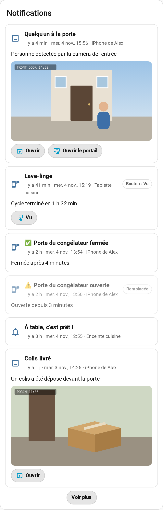
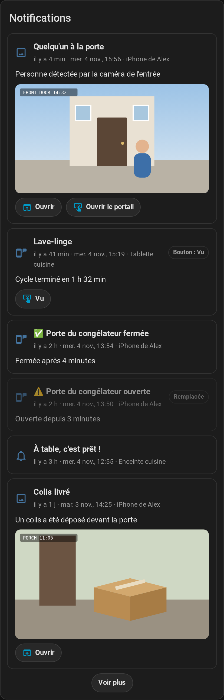

# Notification History

[English](https://github.com/Patafoin/ha-notification-history/blob/main/README.md) · [Français](https://github.com/Patafoin/ha-notification-history/blob/main/README.fr.md)

[](https://github.com/Patafoin/ha-notification-history/releases)
[](https://github.com/Patafoin/ha-notification-history/actions/workflows/validate.yml)
[](https://github.com/Patafoin/ha-notification-history/actions/workflows/tests.yml)

Garde toutes les notifications envoyées par Home Assistant — aux téléphones et tablettes (app Companion, iOS et Android), aux enceintes, par e-mail ou vers toute autre cible `notify` — et les affiche dans une carte de tableau de bord, avec leur image, leur lien et leurs boutons.

Une notification touchée ou effacée disparaît du téléphone, et Home Assistant n'a aucun écran pour la revoir. Cette intégration enregistre chacune au moment de l'envoi.

<p align="center"> </p>

## Fonctions

- **Passé importé** : à la première installation, les notifications encore présentes dans la base du recorder (10 jours par défaut, plus si vous avez changé `purge_keep_days`) sont importées une fois.
- **Détail complet** : titre, message, image (agrandie au toucher), vidéo, son, le lien ouvert par le toucher de la notification (`url` / `clickAction`) et les boutons d'action.
- **Boutons utilisables** : les liens et les boutons `URI` s'ouvrent dans Home Assistant ; les autres boutons redéclenchent `mobile_app_notification_action`, comme l'app (après confirmation).
- **Statut** : remplacée par une notification plus récente avec le même `tag`, retirée par `clear_notification`, bouton touché, effacée (Android seulement).
- **Suppression depuis la carte** : le bouton ✕ masque une notification (avec Annuler). C'est une suppression logique : « Afficher les supprimées » les fait réapparaître, grisées, avec un bouton pour les restaurer. Elles sont purgées comme les autres.
- **Par utilisateur** : un administrateur voit tout ; les autres utilisateurs ne voient que les appareils enregistrés avec leur compte.
- **Frigate** : un bouton « Voir le clip » pour les images envoyées par le proxy de notification de l'intégration Frigate.
- **Notifications persistantes** (option) : les notifications de la cloche de la barre latérale, créées par des automatisations ou des intégrations, marquées « Effacée » quand vous les fermez. Réservé aux admins.

Non enregistrés : les commandes de l'app Companion (`command_webview`, `clear_badge`, `TTS`…), les groupes notify (chaque membre est enregistré à la place, pour ne rien afficher deux fois) et les cibles qui écrivent dans un journal ou un fichier (`file`, `syslog`). Les notifications persistantes, seulement avec l'option ci-dessous.

## Prérequis

- Home Assistant 2026.2 ou plus récent.
- Le recorder (actif par défaut), seulement pour l'import du passé.

## Installation

[](https://my.home-assistant.io/redirect/hacs_repository/?owner=Patafoin&repository=ha-notification-history&category=integration)

1. Paramètres → **Marketplace**, cherchez **Notification History** et sélectionnez **Installer**. Avant Home Assistant 2026.11, faites la même recherche dans **HACS**, téléchargez-la, puis redémarrez Home Assistant.
2. **Paramètres → Appareils et services → Ajouter une intégration → Notification History**.

[](https://my.home-assistant.io/redirect/config_flow_start/?domain=notification_history)

Si la recherche ne la trouve pas, ajoutez le dépôt par son lien : dans la Marketplace, ajout depuis un lien → `https://github.com/Patafoin/ha-notification-history` ; dans HACS, ⋮ → **Dépôts personnalisés** → la même URL, type **Intégration**.

### Manuelle

Copier `custom_components/notification_history` dans `config/custom_components/` et redémarrer Home Assistant.

## Configuration

| Option | Défaut | |
|---|---|---|
| Cibles enregistrées | toutes | Laisser vide pour tout enregistrer. |
| Conserver pendant | 90 jours | |
| Conserver au plus | 500 notifications | |
| Journal | non | Écrit aussi « titre — message » dans le journal. |
| Notifications persistantes | non | Enregistre aussi les notifications de la cloche de la barre latérale, à partir du moment où l'option est activée (celles déjà dans la cloche ne sont pas importées). Seuls les admins les voient. |

L'historique est stocké dans `.storage/notification_history`. Supprimer l'intégration le supprime.

## Carte

La carte est ajoutée automatiquement aux ressources du tableau de bord.

```yaml
type: custom:notification-history-card
title: Notifications        # facultatif
limit: 15                   # affichées avant « Voir plus »
max_height: 500             # facultatif : hauteur fixe en px (ou "60vh"), la liste défile à l'intérieur
targets:                    # facultatif, par défaut : tout ce que vous pouvez voir
  - notify.mobile_app_mon_telephone
show_target: true
channels:                   # facultatif : seulement ces canaux Android
  - Frigate
channels_mode: include      # include : seulement ceux-ci ; exclude : tous sauf ceux-ci
show_channel: false         # afficher le canal Android à côté de la date
groups:                     # facultatif : seulement ces groupes (data.group, iOS et Android)
  - cameras
groups_mode: include        # include : seulement ceux-ci ; exclude : tous sauf ceux-ci
show_group: false           # afficher le groupe à côté de la date
frigate: true
delete: true                # bouton ✕ et bascule « Afficher les supprimées »
show_deleted: false         # afficher les supprimées dès l'ouverture
```

Sans `max_height`, la carte s'allonge à chaque « Voir plus ». Dans une vue en sections, vous pouvez aussi redimensionner la carte : avec un nombre de lignes fixe, la liste défile à l'intérieur. La position de défilement est conservée quand de nouvelles notifications arrivent ou qu'on en charge d'autres.

Une carte par sujet : filtrez sur le canal de notification Android (`data.channel`) que vous utilisez déjà dans vos automatisations, par exemple une carte pour Frigate et une pour le serveur. Les notifications sans canal (iOS, enceintes, e-mail…) n'apparaissent que dans les cartes sans filtre de canal, ou avec `channels_mode: exclude` : ce mode affiche tout sauf les canaux listés (de même pour `groups_mode`), par exemple une carte générale sans les notifications Frigate qui ont leur propre carte. Sur iOS, utilisez plutôt `group` : l'app Companion s'en sert sur iOS comme sur Android pour regrouper les notifications, et l'option `groups` filtre dessus de la même façon.

Elle a aussi un éditeur visuel.

## iPhone et Android

Tout fonctionne avec les deux apps, sauf deux choses que l'app iOS ne fournit pas :

- le statut **Effacée** : seule l'app Android prévient Home Assistant quand une notification est balayée ;
- les **canaux** : Android seulement. Pour filtrer les notifications d'iPhone, utilisez `group`.

Les notifications de caméra d'iOS (`data.entity_id: camera.…`) ont un bouton **Caméra maintenant** : il montre l'image actuelle de la caméra (pas celle du moment de la notification), par une URL signée.

## Liens et images

N'importe quel utilisateur ou automatisation peut envoyer une notification : la carte ne garde que ce qu'elle peut vérifier.

- Seuls les liens `http` et `https` ont un bouton. Le reste (`javascript:`, `data:`, liens propres à l'app comme `entityId:` ou `intent://`) est ignoré.
- Un lien vers une page de votre Home Assistant (même adresse, ou son URL interne ou externe) s'ouvre dans Home Assistant. Les autres sites s'ouvrent dans un nouvel onglet.
- Les images et fichiers de votre Home Assistant qui demandent une connexion (`/media/…`, proxys de caméra et d'image) sont chargés avec une URL signée de courte durée fournie par Home Assistant, comme le fait l'app. Les autres adresses `/api/` ne sont pas chargées. Le proxy de notification de Frigate et `/local/` sont publics et chargés tels quels.
- Les liens écrits dans le message (`https://…` ou markdown `[texte](https://…)`) suivent les mêmes règles ; un lien non autorisé reste du texte.
- Les images s'ouvrent dans une visionneuse par-dessus la carte ; les vidéos et l'audio s'y lisent aussi.

## Relancer un bouton

La carte déclenche `mobile_app_notification_action` avec l'`action` du bouton (et le `tag` de la notification), et `source: notification_history` dans les données. Les automatisations qui écoutent cet évènement en permanence réagissent comme si vous aviez touché le bouton sur le téléphone. Une automatisation qui attendait la réponse (`wait_for_trigger`) a déjà dépassé son délai : elle ne réagira pas.

## Services et API WebSocket

- `notification_history.clear` (`target` facultatif) : vide l'historique. Réservé aux administrateurs.
- WebSocket : `notification_history/list` (`limit`, `before_id`, `targets`, `devices`, `channels`, `groups`, `exclude_channels`, `exclude_groups`, `search`), `notification_history/subscribe`, `notification_history/targets`, `notification_history/channels`, `notification_history/groups`, `notification_history/run_action`, `notification_history/delete` (`record_id`, `deleted: false` pour restaurer ; `list` accepte `include_deleted`). La suppression vaut pour tous les utilisateurs ; peut supprimer quiconque voit la notification. Un utilisateur non administrateur ne reçoit que les notifications de ses propres appareils.

## Comment ça marche (pour les curieux)

- Nouvelles notifications : écoute des évènements `call_service` du domaine `notify`. L'enregistrement se contente de lire les appels, il ne les modifie jamais.
- Notifications persistantes (option) : le rappel que `persistent_notification` propose aux autres intégrations ; il signale chaque notification ajoutée ou fermée.
- Notifications passées : une seule requête en lecture de ces mêmes évènements `call_service` dans la base du recorder, lancée une fois dans l'exécuteur du recorder.
- Téléphones et tablettes : l'appareil et son propriétaire viennent du registre des appareils et de l'entrée `mobile_app` (`device_id`, `device_name`, `user_id`). Le service hérité `notify.mobile_app_<appareil>` est reconnu par le nom que `mobile_app` lui donne ; aucun secret de `mobile_app` (identifiant de webhook, jetons) n'est lu.
- Historique : `.storage/notification_history`, supprimé avec l'intégration. La carte est servie depuis `/notification_history/` et ajoutée comme ressource Lovelace (mode stockage).

La liste des services des plateformes `notify` héritées est une partie interne de Home Assistant. Des tests automatiques tournent chaque semaine sur la dernière version pour repérer tôt un changement.

## Licence

[MIT](https://github.com/Patafoin/ha-notification-history/blob/main/LICENSE)
