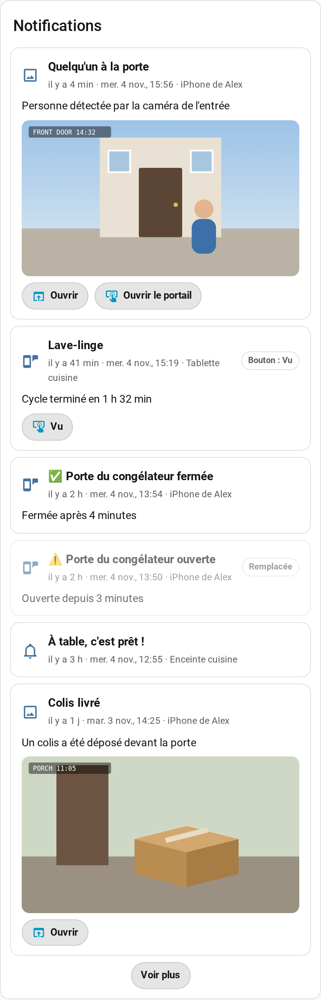
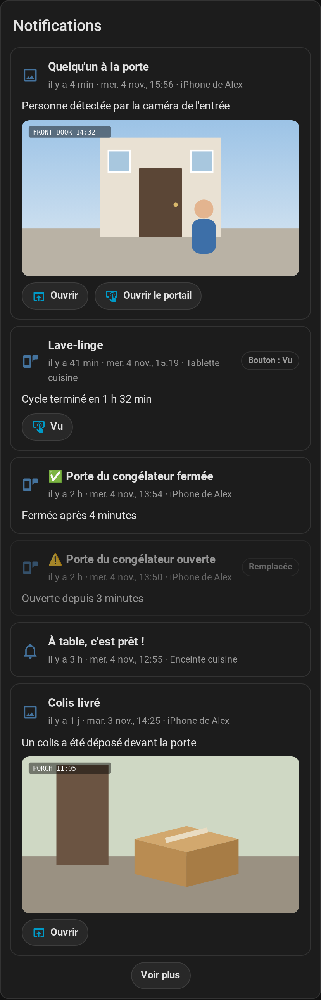

# Notification History

[English](https://github.com/Patafoin/ha-notification-history/blob/main/README.md) · [Français](https://github.com/Patafoin/ha-notification-history/blob/main/README.fr.md)

[](https://github.com/Patafoin/ha-notification-history/releases)
[](https://github.com/Patafoin/ha-notification-history/actions/workflows/validate.yml)
[](https://github.com/Patafoin/ha-notification-history/actions/workflows/tests.yml)

Garde toutes les notifications envoyées par Home Assistant — aux téléphones et tablettes (app Companion, iOS et Android), aux enceintes, par e-mail ou vers toute autre cible `notify` — et les affiche dans une carte de tableau de bord, avec leur image, leur lien et leurs boutons.

Une notification touchée ou effacée disparaît du téléphone, et Home Assistant n'a aucun écran pour la revoir. Cette intégration enregistre chacune au moment de l'envoi.

<p align="center"> </p>

## Fonctions

- **Passé importé** : à la première installation, les notifications encore présentes dans la base du recorder (10 jours par défaut, plus si vous avez changé `purge_keep_days`) sont importées une fois.
- **Détail complet** : titre, message, image (agrandie au toucher), vidéo, son, le lien ouvert par le toucher de la notification (`url` / `clickAction`) et les boutons d'action.
- **Boutons utilisables** : les liens et les boutons `URI` s'ouvrent dans Home Assistant ; les autres boutons redéclenchent `mobile_app_notification_action`, comme l'app (après confirmation).
- **Statut** : remplacée par une notification plus récente avec le même `tag`, retirée par `clear_notification`, bouton touché, effacée (Android seulement).
- **Par utilisateur** : un administrateur voit tout ; les autres utilisateurs ne voient que les appareils enregistrés avec leur compte.
- **Frigate** : un bouton « Voir le clip » pour les images envoyées par le proxy de notification de l'intégration Frigate.

Non enregistrés : les commandes de l'app Companion (`command_webview`, `clear_badge`…) et les cibles qui écrivent dans un journal ou un fichier (`file`, `syslog`, `persistent_notification`, qui a son propre panneau ; voir l'option Notifications persistantes ci-dessous).

## Prérequis

- Home Assistant 2026.2 ou plus récent.
- Le recorder (actif par défaut), seulement pour l'import du passé.

## Installation

[](https://my.home-assistant.io/redirect/hacs_repository/?owner=Patafoin&repository=ha-notification-history&category=integration)

1. Paramètres → **Marketplace**, cherchez **Notification History** et sélectionnez **Installer**. Avant Home Assistant 2026.11, faites la même recherche dans **HACS**, téléchargez-la, puis redémarrez Home Assistant.
2. **Paramètres → Appareils et services → Ajouter une intégration → Notification History**.

[](https://my.home-assistant.io/redirect/config_flow_start/?domain=notification_history)

Si la recherche ne la trouve pas, ajoutez le dépôt par son lien : dans la Marketplace, ajout depuis un lien → `https://github.com/Patafoin/ha-notification-history` ; dans HACS, ⋮ → **Dépôts personnalisés** → la même URL, type **Intégration**.

### Manuelle

Copier `custom_components/notification_history` dans `config/custom_components/` et redémarrer Home Assistant.

## Configuration

| Option | Défaut | |
|---|---|---|
| Cibles enregistrées | toutes | Laisser vide pour tout enregistrer. |
| Conserver pendant | 90 jours | |
| Conserver au plus | 500 notifications | |
| Journal | non | Écrit aussi « titre — message » dans le journal. |
| Notifications persistantes | non | Enregistre aussi les notifications de la barre latérale de HA (découvertes, connexions échouées, réparations…), y compris celles qui ne passent pas par un appel notify, et les marque effacées quand elles sont fermées. Visibles uniquement par les administrateurs. |

L'historique est stocké dans `.storage/notification_history`. Supprimer l'intégration le supprime.

## Carte

La carte est ajoutée automatiquement aux ressources du tableau de bord.

```yaml
type: custom:notification-history-card
title: Notifications        # facultatif
limit: 15                   # affichées avant « Voir plus »
targets:                    # facultatif, par défaut : tout ce que vous pouvez voir
  - notify.mobile_app_mon_telephone
show_target: true
frigate: true
```

Elle a aussi un éditeur visuel.

## Relancer un bouton

La carte déclenche `mobile_app_notification_action` avec l'`action` du bouton (et le `tag` de la notification), et `source: notification_history` dans les données. Les automatisations qui écoutent cet évènement en permanence réagissent comme si vous aviez touché le bouton sur le téléphone. Une automatisation qui attendait la réponse (`wait_for_trigger`) a déjà dépassé son délai : elle ne réagira pas.

## Services et API WebSocket

- `notification_history.clear` (`target` facultatif) : vide l'historique. Réservé aux administrateurs.
- WebSocket : `notification_history/list` (`limit`, `before_id`, `targets`, `devices`, `search`), `notification_history/subscribe`, `notification_history/targets`, `notification_history/run_action`. Un utilisateur non administrateur ne reçoit que les notifications de ses propres appareils.

## Comment ça marche (pour les curieux)

- Nouvelles notifications : écoute des évènements `call_service` du domaine `notify`. L'enregistrement se contente de lire les appels, il ne les modifie jamais.
- Notifications passées : une seule requête en lecture de ces mêmes évènements `call_service` dans la base du recorder, lancée une fois dans l'exécuteur du recorder.
- Téléphones et tablettes : l'appareil et son propriétaire viennent du registre des appareils et de l'entrée `mobile_app` (`device_id`, `device_name`, `user_id`). Le service hérité `notify.mobile_app_<appareil>` est reconnu par le nom que `mobile_app` lui donne ; aucun secret de `mobile_app` (identifiant de webhook, jetons) n'est lu.
- Historique : `.storage/notification_history`, supprimé avec l'intégration. La carte est servie depuis `/notification_history/` et ajoutée comme ressource Lovelace (mode stockage).

La liste des services des plateformes `notify` héritées est une partie interne de Home Assistant. Des tests automatiques tournent chaque semaine sur la dernière version pour repérer tôt un changement.

## Licence

[MIT](https://github.com/Patafoin/ha-notification-history/blob/main/LICENSE)
