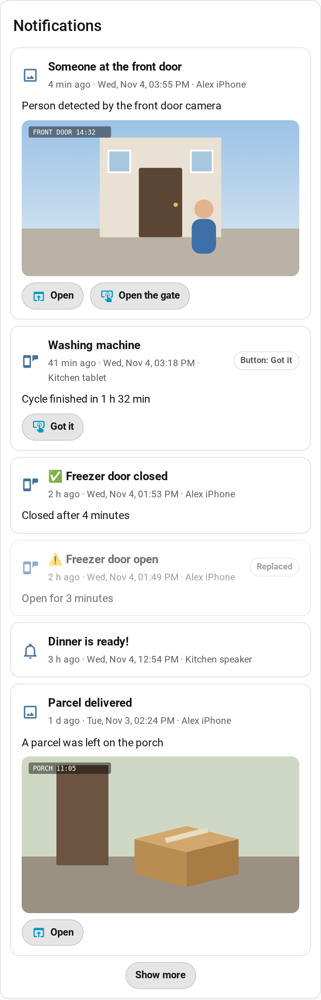
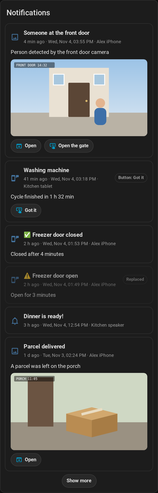

# Notification History

[English](https://github.com/Patafoin/ha-notification-history/blob/main/README.md) · [Français](https://github.com/Patafoin/ha-notification-history/blob/main/README.fr.md)

[](https://github.com/Patafoin/ha-notification-history/releases)
[](https://github.com/Patafoin/ha-notification-history/actions/workflows/validate.yml)
[](https://github.com/Patafoin/ha-notification-history/actions/workflows/tests.yml)

Keeps every notification Home Assistant sends — to phones and tablets (Companion app, iOS and Android), speakers, e-mail or any other `notify` target — and shows them in a dashboard card, with their image, link and buttons.

A notification you tap or swipe away is gone from your phone, and Home Assistant has no screen to see it again. This integration records each one when it is sent.

<p align="center"> </p>

## Features

- **Past notifications imported**: on first setup, the notifications still in the recorder database (10 days by default, more if you changed `purge_keep_days`) are imported once.
- **Full detail**: title, message, image (tap to enlarge), video, audio, the link opened by tapping the notification (`url` / `clickAction`), and the action buttons.
- **Buttons that work**: links and `URI` buttons open in Home Assistant; other buttons fire `mobile_app_notification_action` again, as the app would (after a confirmation).
- **Status**: replaced by a newer notification with the same `tag`, removed by `clear_notification`, button tapped, dismissed (Android only).
- **Per-user**: an admin sees everything; other users only see the devices registered with their account.
- **Frigate**: a “Watch clip” button for snapshots sent through the Frigate integration's notification proxy.

Not recorded: Companion app commands (`command_webview`, `clear_badge`…), and targets that write to a log or a file (`file`, `syslog`, `persistent_notification`, which has its own panel).

## Requirements

- Home Assistant 2026.2 or newer.
- The recorder (enabled by default) only for the import of past notifications.

## Installation

[](https://my.home-assistant.io/redirect/hacs_repository/?owner=Patafoin&repository=ha-notification-history&category=integration)

1. Settings → **Marketplace**, search for **Notification History** and select **Install**. Before Home Assistant 2026.11, do the same search in **HACS**, download it, then restart Home Assistant.
2. **Settings → Devices & services → Add integration → Notification History**.

[](https://my.home-assistant.io/redirect/config_flow_start/?domain=notification_history)

If the search does not find it, add the repository by its link: in the Marketplace, **Add from link** → `https://github.com/Patafoin/ha-notification-history`; in HACS, ⋮ → **Custom repositories** → the same URL, type **Integration**.

### Manual

Copy `custom_components/notification_history` into your `config/custom_components/` folder and restart Home Assistant.

## Configuration

| Option | Default | |
|---|---|---|
| Recorded targets | all | Leave empty to record every target. |
| Keep for | 90 days | |
| Keep at most | 500 notifications | |
| Logbook | off | Also writes “title — message” to the logbook. |

The history is stored in `.storage/notification_history`. Deleting the integration deletes it.

## Card

The card is added to your dashboard resources automatically.

```yaml
type: custom:notification-history-card
title: Notifications        # optional
limit: 15                   # shown before “Show more”
targets:                    # optional, default: everything you can see
  - notify.mobile_app_my_phone
show_target: true
frigate: true
```

It also has a visual editor.

## Replaying a button

The card fires `mobile_app_notification_action` with the button's `action` (and the notification `tag`), with `source: notification_history` in the event data. Automations that listen to this event all the time react as if you had tapped the button on your phone. An automation that was waiting for the answer (`wait_for_trigger`) has already timed out: it will not react.

## Services and WebSocket API

- `notification_history.clear` (optional `target`): deletes the history. Admin only.
- WebSocket: `notification_history/list` (`limit`, `before_id`, `targets`, `devices`, `search`), `notification_history/subscribe`, `notification_history/targets`, `notification_history/run_action`. Non-admin users only get the notifications of their own devices.

## How it works (for the curious)

- New notifications: a listener on `call_service` events of the `notify` domain. Recording only reads the calls, it never changes them.
- Past notifications: a single read-only query of those same `call_service` events in the recorder database, run once in the recorder's executor.
- Phones and tablets: the device and its owner come from the device registry and the `mobile_app` entry (`device_id`, `device_name`, `user_id`). The legacy service `notify.mobile_app_<device>` is matched by the name `mobile_app` gives it; no `mobile_app` secret (webhook id, tokens) is read.
- History: `.storage/notification_history`, deleted with the integration. The card is served from `/notification_history/` and added as a Lovelace resource (storage mode).

The service list of legacy `notify` platforms is an internal part of Home Assistant. Automated tests run every week against the latest release to catch a change early.

## License

[MIT](https://github.com/Patafoin/ha-notification-history/blob/main/LICENSE)
