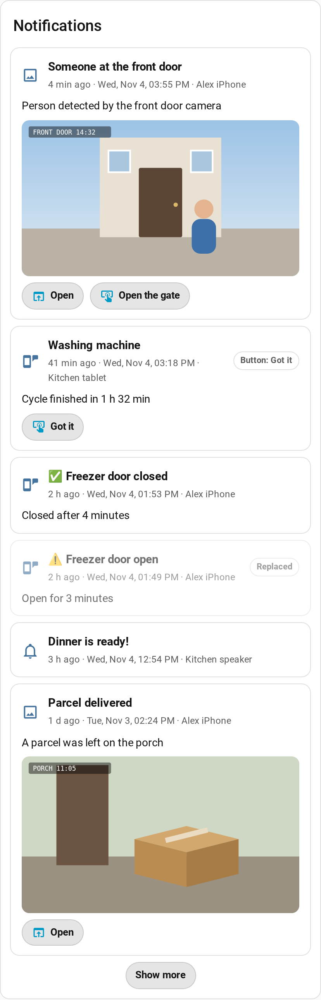
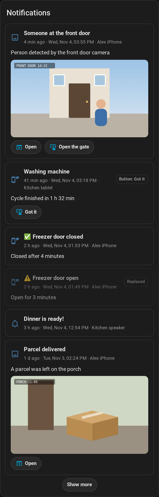

# Notification History

[English](https://github.com/Patafoin/ha-notification-history/blob/main/README.md) · [Français](https://github.com/Patafoin/ha-notification-history/blob/main/README.fr.md)

[](https://github.com/Patafoin/ha-notification-history/releases)
[](https://github.com/Patafoin/ha-notification-history/actions/workflows/validate.yml)
[](https://github.com/Patafoin/ha-notification-history/actions/workflows/tests.yml)

Keeps every notification Home Assistant sends — to phones and tablets (Companion app, iOS and Android), speakers, e-mail or any other `notify` target — and shows them in a dashboard card, with their image, link and buttons.

A notification you tap or swipe away is gone from your phone, and Home Assistant has no screen to see it again. This integration records each one when it is sent.

<p align="center"> </p>

## Features

- **Past notifications imported**: on first setup, the notifications still in the recorder database (10 days by default, more if you changed `purge_keep_days`) are imported once.
- **Full detail**: title, message, image (tap to enlarge), video, audio, the link opened by tapping the notification (`url` / `clickAction`), and the action buttons.
- **Buttons that work**: links and `URI` buttons open in Home Assistant; other buttons fire `mobile_app_notification_action` again, as the app would (after a confirmation).
- **Status**: replaced by a newer notification with the same `tag`, removed by `clear_notification`, button tapped, dismissed (Android only).
- **Delete from the card**: the ✕ button hides a notification (with Undo). It is a soft delete: “Show deleted” brings deleted notifications back, dimmed, with a restore button. They are purged like the others.
- **Per-user**: an admin sees everything; other users only see the devices registered with their account.
- **Frigate**: a “Watch clip” button for snapshots sent through the Frigate integration's notification proxy.
- **Persistent notifications** (optional): the notifications of the sidebar bell, from automations or integrations, marked “Dismissed” once you dismiss them there. Admins only.

Not recorded: Companion app commands (`command_webview`, `clear_badge`, `TTS`…), notify groups (each member is recorded instead, so nothing shows up twice), and targets that write to a log or a file (`file`, `syslog`). Persistent notifications only with the option below.

## Requirements

- Home Assistant 2026.2 or newer.
- The recorder (enabled by default) only for the import of past notifications.

## Installation

[](https://my.home-assistant.io/redirect/hacs_repository/?owner=Patafoin&repository=ha-notification-history&category=integration)

1. Settings → **Marketplace**, search for **Notification History** and select **Install**. Before Home Assistant 2026.11, do the same search in **HACS**, download it, then restart Home Assistant.
2. **Settings → Devices & services → Add integration → Notification History**.

[](https://my.home-assistant.io/redirect/config_flow_start/?domain=notification_history)

If the search does not find it, add the repository by its link: in the Marketplace, **Add from link** → `https://github.com/Patafoin/ha-notification-history`; in HACS, ⋮ → **Custom repositories** → the same URL, type **Integration**.

### Manual

Copy `custom_components/notification_history` into your `config/custom_components/` folder and restart Home Assistant.

## Configuration

| Option | Default | |
|---|---|---|
| Recorded targets | all | Leave empty to record every target. |
| Keep for | 90 days | |
| Keep at most | 500 notifications | |
| Logbook | off | Also writes “title — message” to the logbook. |
| Persistent notifications | off | Also records the notifications of the sidebar bell, from the moment the option is on (the ones already in the bell are not imported). Only admins see them. |

The history is stored in `.storage/notification_history`. Deleting the integration deletes it.

## Card

The card is added to your dashboard resources automatically.

```yaml
type: custom:notification-history-card
title: Notifications        # optional
limit: 15                   # shown before “Show more”
max_height: 500             # optional: fixed height in px (or "60vh"), the list scrolls inside
targets:                    # optional, default: everything you can see
  - notify.mobile_app_my_phone
show_target: true
channels:                   # optional: only these Android channels
  - Frigate
show_channel: false         # show the Android channel next to the date
groups:                     # optional: only these groups (data.group, iOS and Android)
  - cameras
show_group: false           # show the group next to the date
frigate: true
delete: true                # ✕ button and “Show deleted” toggle
show_deleted: false         # start with deleted notifications shown
```

Without `max_height`, the card grows with “Show more”. In a sections view, you can also resize the card instead: with a fixed number of rows, the list scrolls inside it. The scroll position is kept when new notifications arrive or more are loaded.

One card per topic: filter on the Android notification `channel` (`data.channel`) you already use in your automations, for example one card for Frigate and one for the server. Notifications without a channel (iOS, speakers, e-mail…) only show up in cards without a channel filter. On iOS, use `group` instead: the Companion app uses it on both iOS and Android to group notifications, and the `groups` option filters on it the same way.

It also has a visual editor.

## iPhone and Android

Everything works with both apps, except two things the iOS app does not provide:

- **Dismissed** status: only the Android app tells Home Assistant when a notification is swiped away.
- **Channels**: Android only. Use `group` to filter iPhone notifications.

iOS camera notifications (`data.entity_id: camera.…`) get a **Camera now** button: it shows the camera's current image (not the one at the time of the notification), through a signed URL.

## Links and images

Notifications can be sent by any user or automation, so the card only trusts what it can check:

- Only `http` and `https` links get a button. Anything else (`javascript:`, `data:`, app-only links like `entityId:` or `intent://`) is left out.
- A link to a page of your Home Assistant (same address, or its internal or external URL) opens inside Home Assistant. Other sites open in a new tab.
- Images and files of your Home Assistant that need a login (`/media/…`, camera and image proxies) are loaded with a short-lived signed URL from Home Assistant, as the app does. Other `/api/` addresses are not loaded. The Frigate notification proxy and `/local/` are public and are loaded as they are.
- Links written in the message (`https://…` or markdown `[text](https://…)`) follow the same rules; a link that is not allowed stays plain text.
- Images open in a viewer over the card; videos and audio play there too.

## Replaying a button

The card fires `mobile_app_notification_action` with the button's `action` (and the notification `tag`), with `source: notification_history` in the event data. Automations that listen to this event all the time react as if you had tapped the button on your phone. An automation that was waiting for the answer (`wait_for_trigger`) has already timed out: it will not react.

## Services and WebSocket API

- `notification_history.clear` (optional `target`): deletes the history. Admin only.
- WebSocket: `notification_history/list` (`limit`, `before_id`, `targets`, `devices`, `channels`, `groups`, `search`), `notification_history/subscribe`, `notification_history/targets`, `notification_history/channels`, `notification_history/groups`, `notification_history/run_action`, `notification_history/delete` (`record_id`, `deleted: false` to restore; `list` takes `include_deleted`). Deleting is shared by every user and allowed to anyone who can see the notification. Non-admin users only get the notifications of their own devices.

## How it works (for the curious)

- New notifications: a listener on `call_service` events of the `notify` domain. Recording only reads the calls, it never changes them.
- Persistent notifications (option): the callback that `persistent_notification` offers to other integrations; it tells when a notification is added or dismissed.
- Past notifications: a single read-only query of those same `call_service` events in the recorder database, run once in the recorder's executor.
- Phones and tablets: the device and its owner come from the device registry and the `mobile_app` entry (`device_id`, `device_name`, `user_id`). The legacy service `notify.mobile_app_<device>` is matched by the name `mobile_app` gives it; no `mobile_app` secret (webhook id, tokens) is read.
- History: `.storage/notification_history`, deleted with the integration. The card is served from `/notification_history/` and added as a Lovelace resource (storage mode).

The service list of legacy `notify` platforms is an internal part of Home Assistant. Automated tests run every week against the latest release to catch a change early.

## License

[MIT](https://github.com/Patafoin/ha-notification-history/blob/main/LICENSE)
